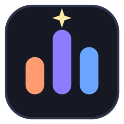

# Tokie



A tiny always-on-top Windows widget that shows how many tokens you have used with **Claude Code** and **Codex**, today and in total. It starts as a small square on your desktop. Click it for the counter, click **Show details** for charts and tables.

Everything is read from the session logs those tools already write on your PC. Nothing is uploaded anywhere.

## Features

- **Three sizes:** mini square, counter card (with a little cat that reacts to your usage), and a details view.
- **Details view:** today / 7 days / 30 days / lifetime, a 30-day chart split by agent, and tables by day, source (CLI, VS Code, desktop) and model.
- **Filters:** All / Codex / Claude, and a switch to include or exclude cache reads (they are usually the biggest part of the total).
- **Codex profile baseline:** type in the lifetime token numbers from your Codex profile page(s) and Tokie adds new usage on top of them.
- **Draggable**, remembers its position, auto-refreshes every 2 minutes, and has a **Turn off** button.

## Download

Grab `Tokie.exe` from the Releases page and double-click it. No Python needed. Windows may show "Windows protected your PC" because the file is not code-signed: choose **More info, Run anyway**.

## Run from source

Needs Python 3.10+ on Windows. The app itself uses only the standard library.

```powershell
pythonw tokie.py
```

## Build the exe

```powershell
pip install -r requirements-dev.txt
.\build.ps1
```

The result is `dist\Tokie.exe`. The icon is drawn by `tools/make_icon.py`.

## Where it reads from

| Tool | Folder |
|---|---|
| Claude Code | `~/.claude/projects/` (or `$CLAUDE_CONFIG_DIR/projects`) |
| Codex | `~/.codex/sessions/` and `archived_sessions/` (or `$CODEX_HOME`) |

Tokie only sees usage logged on the PC it runs on. Usage in chat apps, on other machines, or in logs you have deleted is not counted.

## Your data

Settings live in `%APPDATA%\Tokie\`:

- `codex_profiles.json` - your Codex profile numbers (use **Edit profiles file** in the details view) and the saved baseline.
- `tokie_state.json` - window position.

To start fresh, close Tokie and delete that folder. The Codex profile list starts empty on a new install, so a new user starts from their own local logs.

## How the combined total works

On first run Tokie freezes a baseline: your Codex profile numbers (or the Codex logs found on that day if none are entered) plus the Claude logs found on that day. After that it only adds usage newer than that moment, so nothing is counted twice. To re-baseline, edit the profile numbers and delete the `combined` block in `codex_profiles.json`.

Token counts here are raw log counters. They may not match what a provider's own dashboard or profile page reports.

## License

MIT, see [LICENSE](LICENSE).
